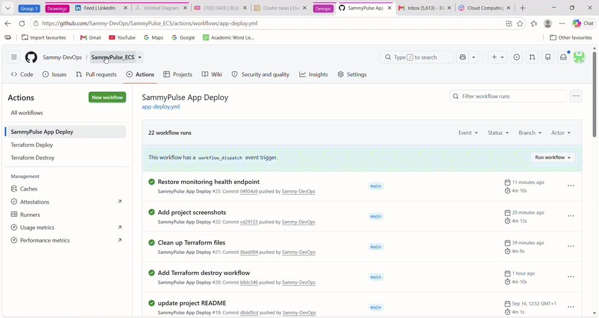
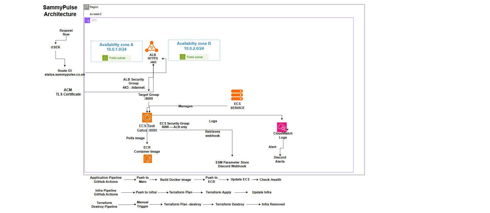
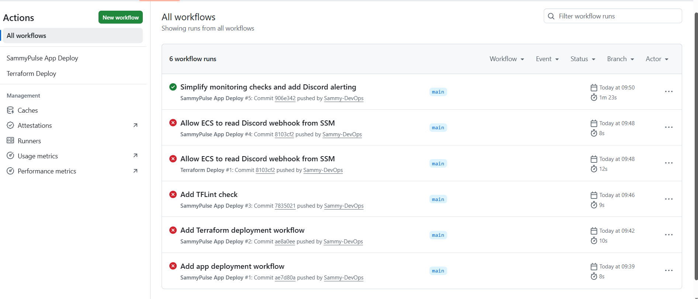
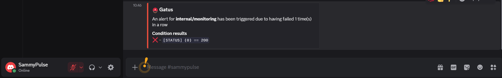
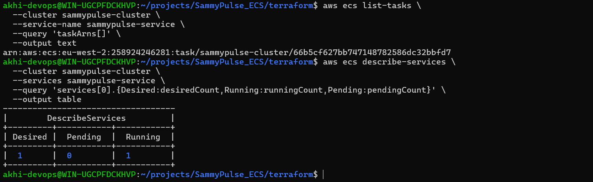
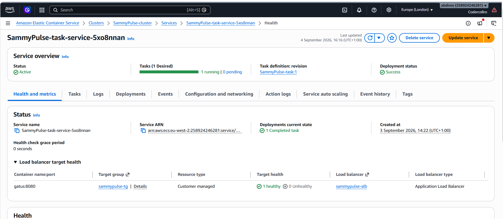

# ecs-project

SammyPulse is an uptime monitor I deployed on AWS ECS Fargate. Terraform builds the infrastructure, GitHub Actions deploys it, and I tested it by breaking it on purpose.

**Live:** [status.sammypulse.co.uk](https://status.sammypulse.co.uk)



## Overview

If a service goes down, the engineers should find out before the users do. SammyPulse runs [Gatus](https://github.com/TwiN/gatus), an open-source health checker. It watches a set of endpoints and sends a Discord alert when one fails, then another when it recovers.

I didn't write the app. My work is everything around it, from the container and AWS network to the pipeline and failure testing. I kept it small on purpose so I could control the cost and explain every resource in it.

It follows the same pattern teams use to run small internal services on AWS. One container sits behind a load balancer, the infrastructure lives in code and every deploy goes through a pipeline.

## Architecture



**User → Route 53 → ALB (HTTPS) → ECS Fargate → SammyPulse :8080**

Route 53 points the domain at an Application Load Balancer in two public subnets across two availability zones. Port 80 redirects to 443 and TLS ends at the ALB. The ALB is the only thing exposed to the internet. The task's security group accepts port 8080 from the ALB's security group and nothing else, and the ALB only routes to the task once `/health` passes.

The task runs on Fargate (0.25 vCPU, 512 MB). Images live in ECR, tagged with the Git commit SHA. The Discord webhook is read from SSM Parameter Store at runtime, and logs go to CloudWatch.

## Tech Stack

**Cloud:** AWS ECS Fargate, ECR, ALB, Route 53, VPC, IAM, SSM Parameter Store, CloudWatch
**IaC:** Terraform (network, ALB, ECR and ECS modules), S3 remote state with native lockfile
**CI/CD:** GitHub Actions with OIDC, separate app, infra and destroy workflows
**App:** Gatus (Go), Docker, Discord alerting

## Key Decisions

- **Fargate over EC2.** It's one small task and I'm the only one looking after it. Fargate means I don't patch servers, and at this size the extra cost is small.
- **No NAT gateway for now.** A NAT gateway would have been one of the biggest costs. The trade-off is that the task needs a public IP, so I locked its security group down to the ALB only.
- **OIDC over AWS keys.** GitHub Actions gets short-lived credentials from an IAM role. There are no AWS access keys stored anywhere.
- **Manual first, then Terraform.** I built it by hand to understand how the pieces connect, then moved it into Terraform modules. I used `moved` blocks so Terraform didn't recreate resources that were already working.

## Pipeline

A push to `main` builds the image and tags it with the commit SHA, so I can trace any running version back to its code. The pipeline pushes it to ECR, updates the ECS service, waits for it to stabilise and then checks the live `/health` endpoint.

Infrastructure changes have their own Terraform workflow. Destroy is a separate manual workflow so it can only happen on purpose.



## Breaking It on Purpose

**Broken endpoint.** I broke one of the monitored endpoints to test the alerting. SammyPulse caught it and sent a Discord alert. When I fixed it I got a recovery message.

**Stopped task.** I stopped the running task to see if ECS would recover. The service wants one task running, so ECS launched a replacement on its own.

**Bad deployment.** I shipped a version that never went healthy. I checked the ECS events and CloudWatch logs, rolled back to the last good image and confirmed `/health` was back up.





## Incidents

**Task running, target unhealthy.** The ECS task was up but the ALB marked it unhealthy. I walked the request path: ALB → target group → task security group. The security group was blocking the ALB on 8080. I allowed 8080 from the ALB security group only, which fixed the health check without opening the port to the internet.



**CI wanted to create ~20 resources that already existed.** My local plan showed no changes, but the pipeline's plan wanted to build everything again. I stopped before applying and traced it to the backend config: CI wasn't reading the same S3 state. Once both pointed at the shared state, I re-ran the plan and confirmed it was clean before continuing.

## What I'd Change at Scale

I'd move the tasks into private subnets and use VPC endpoints to reach AWS services. I'd also run at least two tasks across availability zones, so the ALB still has a healthy target if one fails.

For deployments I'd turn on the ECS circuit breaker for automatic rollback. I'd also add CloudWatch alarms for ALB errors, response time, CPU and memory.

## Run Locally

```bash
git clone https://github.com/Sammy-DevOps/SammyPulse_ECS.git
cd SammyPulse_ECS
docker build -t sammypulse:local ./app
docker run --rm -d --name sammypulse -p 8080:8080 sammypulse:local
curl http://localhost:8080/health   # {"status":"UP"}
```

Then open http://localhost:8080.

## Build Log

I documented the build as a 10-part LinkedIn series:

1. [Part 1](LINK)
2. [Part 2](LINK)
3. [Part 3](LINK)
4. [Part 4](LINK)
5. [Part 5](LINK)
6. [Part 6](LINK)
7. [Part 7](LINK)
8. [Part 8](LINK)
9. [Part 9](LINK)
10. [Part 10](LINK)

## Credit

[Gatus](https://github.com/TwiN/gatus) is built and maintained by TwiN. The deployment, infrastructure, pipeline and testing in this repo are my work.

## Author

**Sammy** · [LinkedIn](LINK) · [GitHub](https://github.com/Sammy-DevOps)
